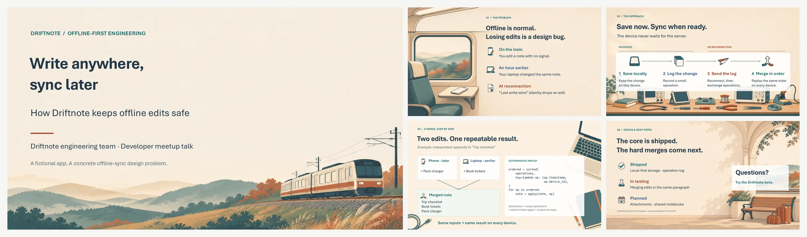
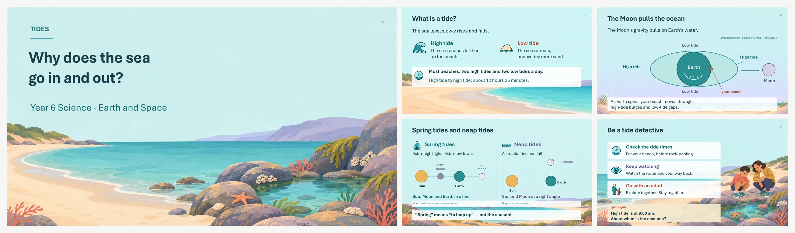
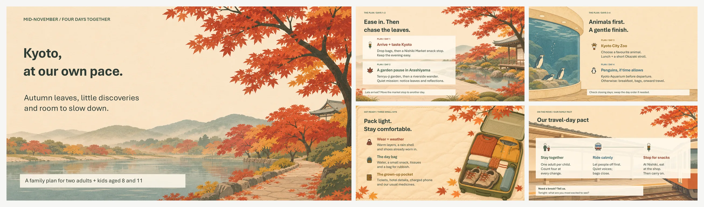
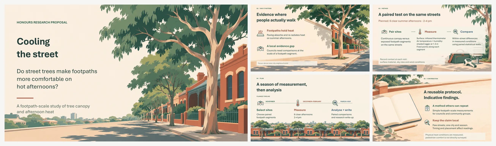

<h1 align="center">Scenic Slides</h1>

<p align="center">
  <b>An agent skill for Codex that turns an outline, rough notes or a one-line request into an editable PowerPoint deck, with a generated scene on every slide and transparent 2D icons.</b>
</p>

<p align="center">
  
  
  
  
</p>

<p align="center">
  
</p>

Good-looking PowerPoint decks that stay editable. Instead of generating each slide as one flat image you can't change, Scenic Slides generates only the scene backgrounds and transparent icons. It then builds the titles, text, arrows, diagrams, timelines and code on top as native PowerPoint objects, so you can still edit every word.

## Demo

[▶ Watch the 70-second demo](docs/scenic-slides-demo.en.mp4)

See the generated slides, transparent icons and editable text in PowerPoint.

## What it does

- **Gives every slide a scene:** a full-bleed illustration that fits that slide's message, with the open space planned for the text. Later scenes use the first one as a reference, so the deck stays in one style.
- **Makes real transparent icons:** one flat 2D icon per idea, with a true alpha background (no white boxes), checked on light, dark and the slide's own scene.
- **Keeps everything else editable:** text, arrows, diagrams, timelines, tables and code stay native, never baked into an image.
- **Plans the story first:** one message per slide, with its evidence and the visual that fits. The visual changes with the job: rows, a flow, a diagram, a timeline or a code block.
- **Handles readability:** text sits in calm space first. Where it can't, a list gets one consistent panel treatment, never panels behind only some items.
- **Checks before handing over:** renders every slide, looks at it, and runs a layout check and an icon alpha check.
- **Doesn't invent numbers:** no made-up market sizes, prices or results. Plans and targets are labelled as plans and targets.

## Examples

Five decks, each made from a different kind of input. Each example folder has the original brief next to the result.

**[Offline sync tech talk](examples/01-offline-sync-talk/)**: from a full slide-by-slide outline, including a code slide.


**[Tides science lesson for ages 10–12](examples/02-tides-lesson/)**: from a full outline, with two diagrams drawn as native shapes.


**[Kyoto family trip](examples/03-kyoto-family-trip/)**: from one paragraph; the skill chose the structure.


**[Phishing awareness onboarding](examples/04-phishing-onboarding/)**: from messy notes pasted as-is.


**[Street trees research proposal](examples/05-street-trees-proposal/)**: from a single prose abstract.


How they were made, how they were checked and their known flaws: [examples/README.md](examples/README.md).

## Install

**Requirements**
- Codex (CLI or app) with its built-in image generation. The skill relies on it for scenes and for icons with transparent backgrounds.
- Python 3 with `python-pptx` and `Pillow`, for building decks and running the checks: `pip install python-pptx pillow`.
- Microsoft PowerPoint is recommended for rendering previews. The examples were made on Windows 11 with PowerPoint 16, driven through COM (`pip install pywin32`).

**As a Codex plugin**

```bash
codex plugin marketplace add chenne0819/scenic-slides-skill
codex plugin add scenic-slides@scenic-slides
```

Start a new Codex session afterwards so the skill is loaded.

**With the `skills` CLI**

```bash
npx skills add chenne0819/scenic-slides-skill -g --agent codex
```

**Manually**

```bash
git clone https://github.com/chenne0819/scenic-slides-skill.git
cp -r scenic-slides-skill/skills/scenic-slides ~/.agents/skills/
```

To use it in one project only, copy the folder into that project's `.agents/skills/` instead.

## Uninstall

Use the method that matches how you installed it.

**Codex plugin**

```bash
codex plugin remove scenic-slides@scenic-slides
codex plugin marketplace remove scenic-slides
```

**`skills` CLI**

```bash
npx skills remove scenic-slides -g -y
```

Leave out `--agent codex` here. With it, the CLI reports success but leaves the skill folder in place.

**Manual install**

```bash
rm -rf ~/.agents/skills/scenic-slides
```

On Windows PowerShell, use `Remove-Item -Recurse -Force ~/.agents/skills/scenic-slides` instead.

Start a new Codex session afterwards.

## Usage

Ask for a deck, or call the skill by name:

```text
$scenic-slides Make a 5-slide science lesson for 10–12 year olds on why the sea
goes in and out. Simple language, large text, and a quiz at the end.
```

```text
$scenic-slides Turn these notes into a 15-minute onboarding deck for new hires.
Keep it friendly. <paste your notes>
```

You can give it a full outline, a paragraph, raw notes or an abstract. The more you say about audience, length and language, the less it has to guess. It also polishes existing decks: name the slides to keep and it leaves them alone.

The [briefs in the examples](examples/) show the inputs used for the gallery above.

## How it works

1. **Confirm the scope:** read the request and any existing deck; settle the audience, language, length and which slides are already approved.
2. **Plan the story:** one main message per slide, the evidence for it, and the visual that fits.
3. **Generate the scenes:** one full-slide background per slide. Later scenes use the first approved one as a style reference, and people keep fixed descriptions.
4. **Generate the icons:** one transparent pictogram per parallel point, matched to the first approved icon.
5. **Build native slides:** text, arrows, diagrams, timelines, code and light tables in PowerPoint, with speaker notes on every slide.
6. **Check and fix:** render each slide, inspect it, run `check_layout.py` and `check_icon_alpha.py`, and fix every finding or explain it in the delivery notes.

## What's in the skill

```
skills/scenic-slides/
├── SKILL.md                     rules for story, scenes, icons, editability and readability
├── agents/openai.yaml           Codex display name and default prompt
├── references/
│   ├── visual-recipes.md        composition table, prompt templates, typography, panels, rows and tables
│   └── quality-checks.md        pre-delivery checklist and test cases for the skill itself
└── scripts/
    ├── check_layout.py          read-only PPTX check: overflow, overlap, edges, contrast, panels, table style
    └── check_icon_alpha.py      read-only alpha-channel check for raster icons
```

The two scripts never modify files. You can run them on any deck or icon:

```bash
python skills/scenic-slides/scripts/check_layout.py path/to/deck.pptx
python skills/scenic-slides/scripts/check_icon_alpha.py path/to/icon.png
```

## Limitations

- Made and tested with Codex. Other agents that can read `SKILL.md` may load it, but the scenes and transparent icons need an image tool with a transparent-background option.
- Previews and fonts were checked in PowerPoint 16 on Windows. Keynote, Google Slides and LibreOffice were not tested. English decks default to Aptos, which viewers without Microsoft 365 will see as a substitute font.
- A 5-slide deck took Codex 16–20 minutes and 11–16 image generations in the example runs.

## License

[MIT](LICENSE)
